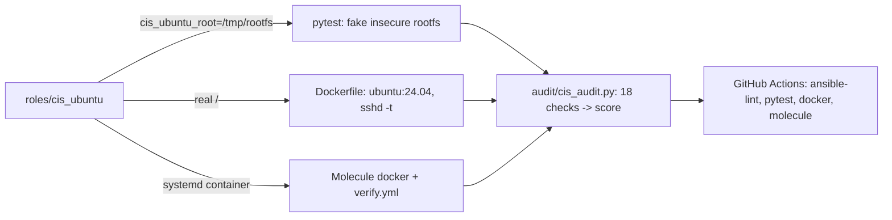

# ansible-cis-ubuntu: CIS Level 1 subset hardening role, tested

> **Lab project.** This covers an **18-control subset** of the CIS Ubuntu Linux 22.04/24.04 Benchmark L1, not the full benchmark (~250 controls). Control numbers are approximate and vary between benchmark versions.

## Problem
Fresh Ubuntu servers ship with `PasswordAuthentication yes`, `PASS_MAX_DAYS 99999`, unused kernel modules loadable, and no audit rules. Hardening by hand drifts. This role makes it **idempotent code**. An **independent audit script** (it doesn't read the role's variables) scores the result, so the test proves the outcome rather than restating the inputs.

## Architecture


Controls: modprobe blacklist (cramfs, usb-storage, dccp, sctp...), 12 sysctls (ASLR, redirects, source routing, syncookies, suid_dumpable), core-dump limits, an sshd drop-in (root login, password auth, MaxAuthTries 4, idle timeout, banner), sshd_config mode 0600, password aging, login banners, permissions on passwd/shadow, and auditd identity/scope/time rules.

**Design choice:** `cis_ubuntu_root` prefixes every path, so the same role can harden a mounted golden image or a test rootfs. Live reloads (`sysctl --system`, `ssh reload`) only run when the root is `/`.

## Run
```bash
python3 -m venv .venv && .venv/bin/pip install ansible-core pytest ansible-lint
PATH=.venv/bin:$PATH pytest -q
bash tests/make_rootfs.sh /tmp/r && python3 audit/cis_audit.py /tmp/r      # before
ANSIBLE_ROLES_PATH=roles ansible-playbook -i localhost, tests/site_test.yml -e cis_ubuntu_root=/tmp/r
python3 audit/cis_audit.py /tmp/r                                          # after
docker build -t cis-test . && docker run --rm cis-test
cd roles/cis_ubuntu && molecule test
# real host (careful: disables SSH password auth, so have a key in place first!)
ansible-playbook -i myhost, -b site.yml   # with roles: [cis_ubuntu]
```

## Results (actual run, 2026-10-11, ansible-core 2.21.5)
| Step | Result |
|---|---|
| Audit of stock-like insecure rootfs | **0/18** (`results/audit_before.txt`) |
| Converge run 1 | ok=12 **changed=10** failed=0 (`results/converge_1.log`) |
| Converge run 2 (idempotence) | ok=12 **changed=0** |
| Audit after | **18/18** (`results/audit_after.txt`) |
| ansible-lint (production profile) | **0 failures, 0 warnings** after fixes (`results/ansible-lint.log`) |
| pytest | **3 passed** |

ansible-lint initially flagged un-prefixed role variables, unnamed tasks and long lines. I fixed all of them and renamed variables to `cis_ubuntu_*`.

**Not run:** the Docker image build and Molecule (no Docker daemon on my lab machine), and applying the role to a real host (I didn't harden my shared lab machine). The rootfs test checks file content and permissions but **not** runtime effects such as the kernel actually refusing to load cramfs.

## Limitations
- This is a subset. It leaves out partitioning (/tmp noexec), AppArmor, PAM pwquality/faillock, UFW, AIDE, and journald settings.
- The audit parser is simplified: it doesn't handle sshd `Match` blocks or `sysctl` overrides in `/run` or `/usr/lib`.
- `PasswordAuthentication no` can lock you out. On a real host, validate key access first (use `sshd -t` plus a second session).
- For full coverage, compare against OpenSCAP (`ssg-ubuntu2404`) or CIS-CAT.

## Sources
- CIS Ubuntu Linux Benchmarks: https://www.cisecurity.org/benchmark/ubuntu_linux
- Ubuntu Security Guide (USG): https://ubuntu.com/security/certifications/docs/usg
- ansible-lockdown/UBUNTU22-CIS (reference only, not copied): https://github.com/ansible-lockdown/UBUNTU22-CIS
- Molecule docs: https://ansible.readthedocs.io/projects/molecule/
